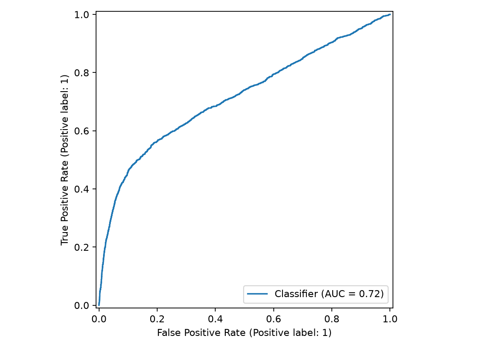
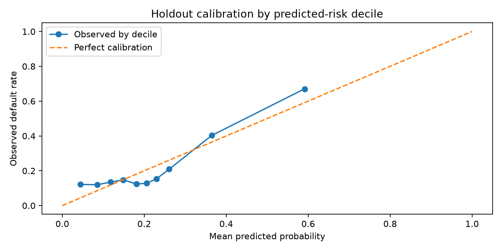

# Credit Portfolio Risk Monitoring

**Python · SQL · scikit-learn · Logistic Regression · Credit Risk**

## Overview

This project examines how a simple default-risk model could support credit portfolio monitoring when a team can review only a limited share of accounts. It uses the historical **UCI Default of Credit Card Clients** dataset from Taiwan (30,000 accounts) and evaluates model ranking on a separate 7,500-account holdout.

The central question is: **If only 20% of accounts can receive additional review, how many observed defaults are concentrated in the highest-scored group?**

## Findings

| Holdout result | Value |
| --- | ---: |
| ROC-AUC | 0.716 |
| Average precision (PR-AUC) | 0.502 |
| Brier score | 0.146 |
| Accounts prioritized | 1,500 / 7,500 (20%) |
| Defaults in prioritized accounts | 805 / 1,659 |
| Observed defaults captured | **48.5%** |
| Observed default rate in prioritized group | 53.7% |
| Concentration versus random selection | **2.43x** |

The review analysis is **retrospective**: it shows that high-scored accounts contained a greater share of observed defaults, not that an intervention would have prevented those defaults.

## Model and analysis

- Load the UCI historical credit-card dataset (dataset ID 350), preprocess numerical features, and identify `X1` / `LIMIT_BAL` as the credit-limit field.
- Train a standardized logistic regression classifier using a stratified 75/25 random train-test split.
- Evaluate ROC-AUC, average precision, Brier score, and calibration by predicted-risk decile.
- Rank holdout accounts by predicted default probability and evaluate a fixed 20% review capacity.
- Store holdout scores in SQLite and summarize portfolio risk bands using SQL.
- Calculate illustrative loss sensitivity scenarios under assumed PD multipliers and an assumed 60% loss-given-default (LGD).

### ROC curve



### Calibration



The calibration plot indicates discrepancies between predicted and observed default rates, especially in higher-risk segments. This limits the reliability of probability-based monetary loss estimates.

## Illustrative loss scenarios

Credit limits are used **only as a proxy for exposure**, not as actual exposure at default. The historical credit limits are denominated in New Taiwan dollars (TWD). The results below use a fictional **60% LGD**; the PD multipliers are also hypothetical.

| Scenario | PD multiplier | Illustrative loss (TWD) |
| --- | ---: | ---: |
| Baseline | 1.00x | NT$128.9 million |
| Downturn | 1.25x | NT$160.9 million |
| Severe | 1.60x | NT$204.6 million |

These are scenario sensitivity calculations, **not validated expected credit losses or macroeconomic forecasts**.

## Files

- `analyze.py` — dataset ingestion, logistic regression, evaluations and outputs
- `portfolio_queries.sql` — SQL portfolio summaries
- `requirements.txt` — Python dependencies
- `review_strategy.csv` — top-20% review analysis
- `outputs/model_metrics.csv` — holdout classification metrics
- `outputs/stress_scenarios.csv` — illustrative loss sensitivity
- `outputs/sql_risk_summary.csv` — segment-level SQL results
- `outputs/roc_curve.png`, `outputs/calibration.png` — diagnostic charts
- `Credit_Portfolio_Risk_Report.pdf` — full case-study report

## Run locally

Install dependencies and run:

```bash
python -m pip install -r requirements.txt
python analyze.py
```

On systems where `python` is not on PATH, use the installed Python executable directly. The script downloads the source dataset on execution and regenerates the `outputs/` directory.

## Limitations and source

This is a historical educational case study, not an underwriting or credit-decision tool. The random holdout is not an out-of-time test, and the dataset does not establish applicability to Canada or current portfolios. Calibration, fair lending, drift, legal requirements, model governance, and operational costs would require additional testing. The credit-limit variable is not true EAD, and recovery outcomes are unavailable.

**Dataset:** Yeh, I.-C. and Lien, C.-h. (2009), *The comparisons of data mining techniques for the predictive accuracy of probability of default of credit card clients*. [UCI Machine Learning Repository — Default of Credit Card Clients](https://archive.ics.uci.edu/dataset/350/default+of+credit+card+clients).
